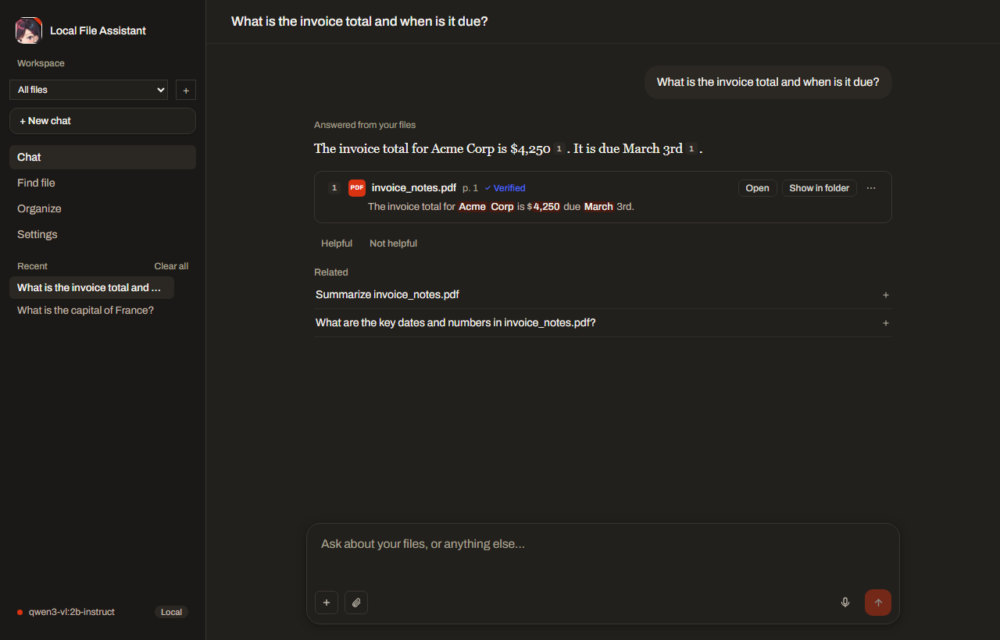
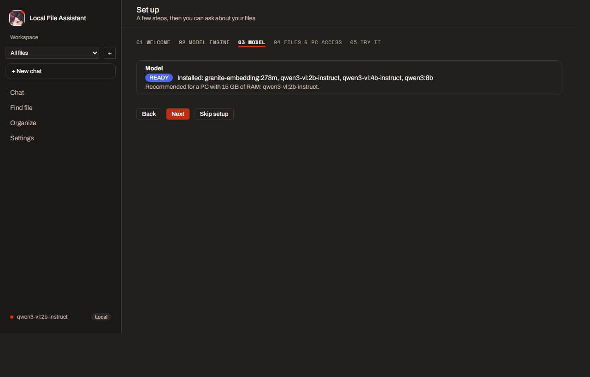
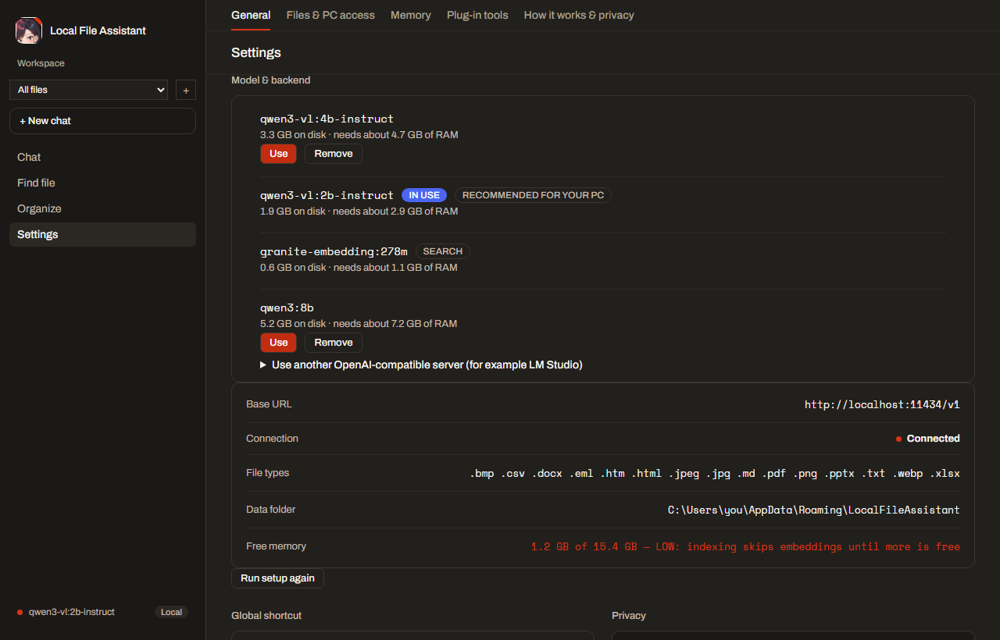
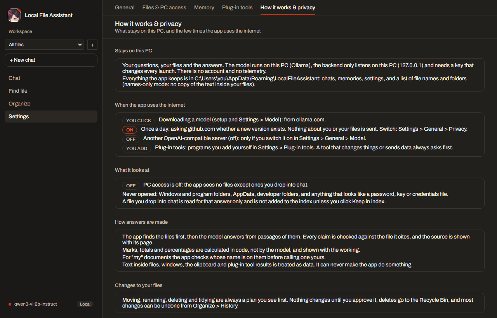

# Local File Assistant

Ask about your files in plain words and get answers from them, with the file and page each answer came from.
Everything runs on your PC with [Ollama](https://ollama.com) and a small model (qwen3-vl 2B, which can also read
images); nothing you ask or open leaves the machine.

What makes it different from a general chat-with-documents app:

- **Finds files anywhere on the PC.** Describe a file ("my class 12 marksheet", "the rent agreement from March")
  and it finds it by name, date and type across the drives you allow, even photos named `IMG-2025…jpg`.
- **Knows whose document it is.** For "my" documents it checks the name on the document before calling it yours.
- **Numbers are calculated, not guessed.** Marks, totals and percentages are worked out in code and shown with the working.
- **Every answer is checked.** Each claim is matched against the file it cites; the source shows **Verified** or not.
- **Nothing changes without you.** Moving, renaming, deleting and tidying are always a plan you approve first.



## Install (Windows 11)

1. Run `LocalFileAssistant-Setup-<version>.exe`. No Python needed.
2. The first launch opens **Set up**. If Ollama isn't installed, **Download Ollama** opens ollama.com/download in
   your browser (the app never runs an installer itself); install it and click **Check again**.
3. Setup then downloads the model through Ollama with a progress bar (about 2.5 GB) and asks which drives it may
   look at. Click one of the example questions to try it.



The app updates itself at most once a day from GitHub Releases ("Update ready, restart?"; it never restarts on its
own). Turn that off in Settings > General > Privacy.

## What you can do

- **Chat** with your files (AUTO), only with your files (FILES ONLY: if they don't have it, it says so instead of
  answering from general knowledge), or without them (CHAT).
- **Drop a file into the chat** (or use the paperclip) to ask about it. It is read for that answer only.
- **Workspaces**: a name, some folders and an answer style. Chat in a workspace only answers from its folders.
- **Settings > Model**: download, use or remove Ollama models, or point chat at another OpenAI-compatible server
  such as LM Studio (off by default; a server on another computer needs a second confirmation).
- **Settings > Plug-in tools**: add local MCP servers. Their tools are read-only unless you mark them; a tool that
  changes things always shows an approval card first.
- **Find file**, **Organize** (tidy folders with a plan you approve; undo from History), the **Ctrl+Shift+Space** overlay.



## Privacy

Settings > **How it works & privacy** lists exactly when the app uses the internet (a model download you click, the
daily update check, and anything you switch on yourself) with the live state of each switch.



## 2-minute demo

Before: put a marksheet (PDF or a phone photo) in Downloads, and allow drive C: in setup (or Settings > Files & PC access).

| Time | Do | What to point out |
|---|---|---|
| 0:00 | Open the app, type **find my marksheet** | It finds the file by describing it, not by its name; the steps show what it searched. |
| 0:30 | Ask **whose document is this?** | It reads the name on the marksheet and says whether it is yours; someone else's is skipped, not called yours. |
| 1:00 | Ask **what percentage did I get? show the working** | The total and percentage come from code, line by line, with the page cited and marked Verified. |
| 1:30 | Drag any PDF from the Desktop onto the chat and ask **what is the due date?** | Answered from that file with a page citation; it is not added to the index; the model never left the PC. |
| 1:50 | Open Settings > How it works & privacy | Every way data could leave the PC, and that each one is off or asks first. |

## For developers

```powershell
scripts\setup.ps1                  # venv + Python packages + npm packages
ollama pull qwen3-vl:2b-instruct   # or let the setup wizard pull it
ollama pull granite-embedding:278m
cd ui; npm run dev                 # opens the app; it starts the backend itself
```

```powershell
cd backend
.venv\Scripts\python.exe -m pytest            # no model server needed
.venv\Scripts\python.exe eval\run_eval.py     # answer quality on the real model (Ollama running)
cd ..\ui; npm test; npm run build:web          # updater rule; web build
```

Building and publishing releases: [docs/RELEASING.md](docs/RELEASING.md). Manual checks on Windows:
[docs/TESTING-ON-WINDOWS.md](docs/TESTING-ON-WINDOWS.md). Design: [docs/ARCHITECTURE.md](docs/ARCHITECTURE.md).
